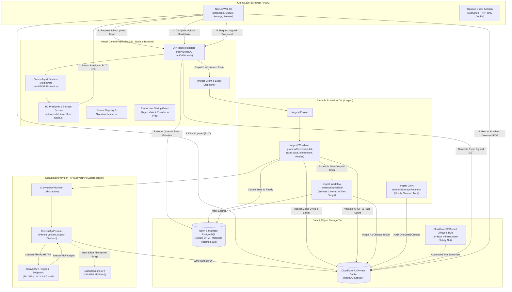
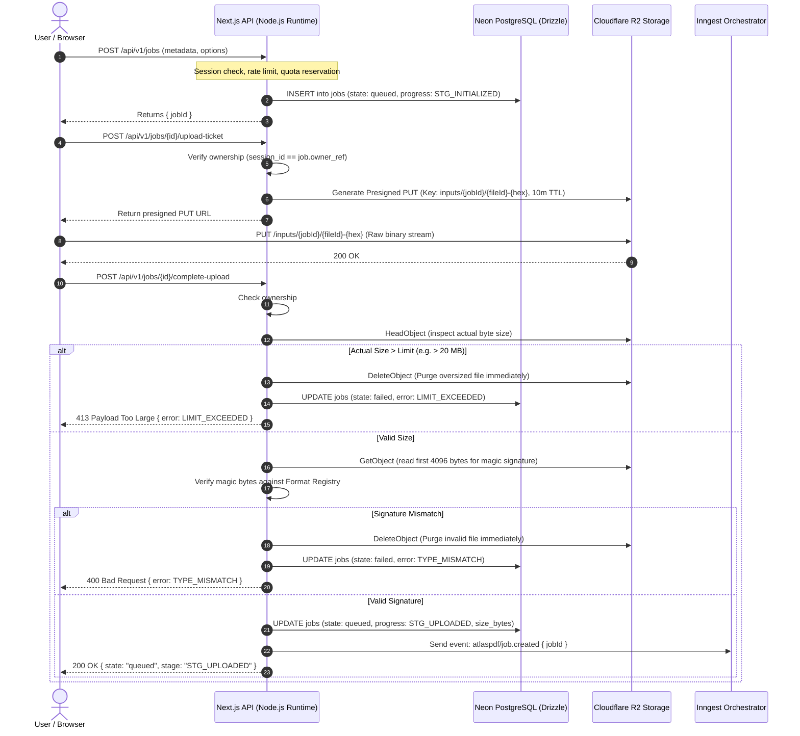

# AtlasPDF System Architecture & Technical Design Document

**Document Version:** 1.1  
**Target Release:** MVP (P1)  
**Date:** 29 October 2026  
**Status:** Approved Technical Architecture  

---

## 1. Executive Summary & Approved Direction

AtlasPDF is a universal, format-aware, privacy-first file-to-PDF conversion platform. It provides everyday users and professionals with a dependable, transparent conversion workflow without falsely promising universal conversion for arbitrary binary data.

### Approved Technology Stack
In accordance with engineering leadership directives, AtlasPDF is designed as a cloud-native, serverless architecture that completely eliminates local runtime dependencies on the .NET SDK, Docker Desktop, or local PostgreSQL daemons:
- **Application & Control Plane:** Next.js (App Router) with TypeScript, hosted on **Vercel** targeting the **Node.js runtime (`nodejs20.x` or `nodejs22.x`)**. (The Edge runtime is explicitly excluded for database, storage, and file processing operations).
- **Relational Database:** **Neon Serverless PostgreSQL**, accessed via **Drizzle ORM** with WebSocket/HTTPS connection pooling.
- **Private Object Storage:** **Cloudflare R2** (S3-compatible, private bucket, zero egress fees, with a 24-hour lifecycle safety net).
- **Durable Orchestration & Queues:** **Inngest** (event-driven step functions, bounded retries, durable timers, and scheduled reconciliation).
- **Conversion Provider:** **ConvertAPI** as the initial cloud conversion SaaS subprocessor, abstracted behind a pluggable provider contract with regional endpoints and pinned parameters.
- **Client Experience:** Responsive web application (desktop & mobile) with PWA installability, guest session support, and WCAG 2.2 AA compliance.
- **Local Developer Experience:** 100% Node.js/TypeScript toolchain using cloud dev instances (Neon branching, R2 dev bucket) and lightweight mocks for offline unit/integration testing.

---

## 2. High-Level System Architecture

The following diagram illustrates the component topology, network boundaries, and data flows of AtlasPDF:



---

## 3. Upload Flow & Presigned URL Security

To safeguard serverless API compute and prevent payload bottlenecking, AtlasPDF adopts a direct-to-storage presigned upload architecture.

### 3.1 Presigned PUT URL Reuse Caveat & Mitigation
> **CRITICAL SECURITY NOTE:** Standard S3/Cloudflare R2 presigned PUT URLs remain cryptographically valid until their expiration timestamp. They **cannot be treated as one-time tickets** at the storage layer; a client holding an unexpired presigned PUT URL could theoretically upload to the same key multiple times before expiration.

To eliminate vulnerabilities stemming from presigned URL reuse, AtlasPDF enforces a defense-in-depth model:
1. **Unique Object Keys per Ticket:** Every upload ticket allocates a fresh, non-deterministic object key incorporating random cryptographic entropy:
   `inputs/{jobId}/{fileId}-{randomHex16}.{sanitizedExt}`
2. **Short Expiration Window:** Presigned PUT URLs are configured with a strict **10-minute maximum Time-To-Live (TTL)**.
3. **Pre-Upload Quota Allocation:** Quotas are reserved in Neon before the presigned URL is issued.
4. **Post-Upload HEAD Verification & Oversized File Handling:**
   - *Explaining the Control:* Server-side `HeadObject` detects oversized files **after** they have reached storage (since a client could stream more bytes than anticipated if the client ignores declared content lengths).
   - *Abuse Mitigation:* If `HeadObject` reveals a file size exceeding the job's quota (e.g. >20 MB), the control plane immediately:
     1. Issues an immediate `DeleteObject` command to Cloudflare R2 to purge the oversized blob.
     2. Marks the job as `failed` with error code `LIMIT_EXCEEDED`.
     3. Increments an abuse penalty counter against the session/IP.
5. **Additional Abuse Controls:**
   - IP-based velocity limits (maximum 10 upload ticket requests per minute per IP).
   - Cloudflare WAF rate limiting on `/api/v1/jobs/*/upload-ticket`.
   - Content-type validation matching the requested format family.

### 3.2 Upload Confirmation Handshake



---

## 4. Multi-Location Storage & Retention Lifecycle

AtlasPDF distinguishes retention and deletion behaviors across all four distinct storage environments:

| Storage Location | Artifacts Stored | Retention Policy & Target | Deletion Behavior & Fallbacks |
| :--- | :--- | :--- | :--- |
| **1. Cloudflare R2 (`inputs/*`)** | Original user uploads | Target cleanup initiation at **60 minutes** past job completion (`ready`, `failed`, `cancelled`). | **Durable Inngest cleanup:** Step triggers `DeleteObjectCommand`. If transient failure occurs, Inngest retries with exponential backoff. Hourly reconciliation cron audits and purges any missed objects. **Safety Net:** 24-hour Cloudflare R2 bucket lifecycle rule hard-deletes any object older than 1 day. |
| **2. Cloudflare R2 (`outputs/*`)** | Converted PDF results | Target cleanup initiation at **60 minutes** past job completion. Presigned download URLs expire in **5 minutes**. | Same as above. Immediate access revocation occurs in the database upon user clicking "Delete Now" or upon reaching 60 minutes. |
| **3. ConvertAPI File Server** | Temporary input/output processing caches | Ephemeral subprocessor cache. Files are retained for a **maximum of 3 hours** per ConvertAPI terms. | When ConvertAPI returns a `FileId` for uploaded or converted artifacts, AtlasPDF issues `DELETE https://{region}.convertapi.com/d/{FileId}`. **Caveat:** Immediate provider deletion is best-effort and subject to upstream API reachability; 3-hour automatic purge is guaranteed by ConvertAPI. |
| **4. Neon DB & Telemetry Logs** | Job metadata, file records, operational logs | Database metadata retained for **30 days** for quota tracking and billing metrics. Logs retained for **7–14 days**. | Metadata contains sanitized display names and safe error codes; **zero file content is stored**. Daily cron cleans metadata > 30 days. Logs strictly redact filenames, file contents, tokens, and signed URLs. |

### 4.1 Clarification on the 60-Minute Retention SLA
> **IMPORTANT PRIVACY CLARIFICATION:** AtlasPDF **does not** claim an unqualified guarantee that every file is mathematically expunged at exactly minute 60.000.  
> Instead, AtlasPDF defines an **operational target for initiating automated cleanup at 60 minutes**, executed through durable Inngest functions with automatic retries, monitored via cleanup lag metrics, audited by an hourly storage reconciliation cron, and backed by an immutable 24-hour Cloudflare R2 bucket lifecycle rule.

---

## 5. Third-Party Processing & Privacy (ConvertAPI Subprocessor)

AtlasPDF utilizes **ConvertAPI** as its initial cloud conversion provider. In compliance with privacy regulations (GDPR, CCPA) and transparency guidelines, the following terms and operational controls are enforced:

### 5.1 Subprocessor Disclosures
- **Data Transfer:** Conversion input files are transferred via HTTPS to ConvertAPI endpoints solely for executing the requested conversion.
- **Regional Processing:** ConvertAPI provides regional endpoints. AtlasPDF configures its provider adapter to target jurisdictionally compliant endpoints:
  - European Union: `https://eu-v2.convertapi.com`
  - United States: `https://us-v2.convertapi.com`
  - United Kingdom: `https://uk-v2.convertapi.com`
  - Canada: `https://ca-v2.convertapi.com`
  - Global / Default: `https://v2.convertapi.com`
- **Data Retention by Subprocessor:** ConvertAPI operates ephemerally. Files stored on its file server during conversion are automatically expunged after a maximum of **3 hours**.
- **Manual Deletion via API:** When ConvertAPI provides a `FileId`, AtlasPDF's adapter executes an immediate deletion call (`DELETE https://{region}.convertapi.com/d/{FileId}`).
- **No AI Model Training:** ConvertAPI terms explicitly confirm that uploaded documents are not used to train artificial intelligence or machine learning models.
- **Security & Certifications:** ConvertAPI maintains SOC 2 Type 2 and ISO 27001 certifications; payload encryption is enforced in transit (TLS 1.2/1.3) and at rest (AES-256).

---

## 6. Conversion Provider Abstraction & Mock Safety

Conversion capabilities are decoupled behind an engine adapter contract (`IConversionProvider`).

### 6.1 Provider Interface Contract

```typescript
export interface ConversionInput {
  jobId: string;
  inputKey: string;
  sourceFormat: string;
  targetFormat: "pdf";
  options: Record<string, unknown>;
}

export interface ConversionOutput {
  outputKey: string;
  outputSizeBytes: number;
  engineVersion: string;
  providerFileId?: string; // Captured for ConvertAPI DELETE /d/{FileId}
  warnings: string[];
}

export interface IConversionProvider {
  readonly providerId: string;
  supports(sourceFormat: string): boolean;
  convert(input: ConversionInput): Promise<ConversionOutput>;
  deleteProviderFile?(fileId: string): Promise<boolean>;
  getHealth(): Promise<{ healthy: boolean; latencyMs?: number }>;
}
```

### 6.2 Production Startup Guard for Mock Provider
To eliminate any catastrophic risk of deploying the test `MockConversionProvider` to production, a strict startup assertion is embedded in the application initialization layer:

```typescript
// src/lib/conversion/factory.ts
export function initializeConversionProvider(): IConversionProvider {
  const providerType = process.env.CONVERSION_PROVIDER || "convertapi";

  if (process.env.NODE_ENV === "production") {
    if (providerType === "mock") {
      throw new Error(
        "FATAL CONFIGURATION ERROR: MockConversionProvider is strictly prohibited in production! " +
        "Ensure CONVERSION_PROVIDER is set to an approved production provider (e.g., 'convertapi')."
      );
    }
  }

  if (providerType === "mock") {
    if (process.env.NODE_ENV !== "test" && process.env.ENABLE_LOCAL_MOCK !== "true") {
      throw new Error("MockConversionProvider is only permitted in test or explicitly enabled local development.");
    }
    return new MockConversionProvider();
  }

  return new ConvertApiProvider({
    secret: process.env.CONVERTAPI_SECRET!,
    region: process.env.CONVERTAPI_REGION || "us",
  });
}
```

---

## 7. Supported Format Evidence Matrix

In strict compliance with truth-in-advertising guidelines, every format is tracked across four rigorous lifecycle gates:
1. **Planned:** Requirements and option schemas defined.
2. **Provider capability confirmed:** Subprocessor official documentation confirms conversion support.
3. **Integration tested:** Automated end-to-end test passes on representative test samples.
4. **Approved for production:** Golden-file regression corpus passes; layout and font caveats verified.

### 7.1 Format Support Matrix

| Format Family | Extensions | Support Status | Conversion Engine | Release Notes & Limitations |
| :--- | :--- | :---: | :--- | :--- |
| **Word Processing** | DOCX, DOC, RTF, ODT | **Provider capability confirmed** | ConvertAPI Office Engine | Macros disabled. Pinned engine parameters. |
| **Spreadsheets** | XLSX, XLS, ODS, CSV | **Provider capability confirmed** | ConvertAPI Excel Engine | Sheet selection & fit-to-width supported. CSV rendered as formatted table. |
| **Presentations** | PPTX, PPT, ODP | **Provider capability confirmed** | ConvertAPI PowerPoint Engine | Slide-range selection supported. Speaker notes omitted by default. |
| **Raster Images** | JPG, JPEG, PNG, TIFF, BMP, WebP | **Provider capability confirmed** | ConvertAPI Image Engine | EXIF orientation preserved. Contain/cover fit presets. |
| **Text & Markup** | TXT, MD, HTML | **Provider capability confirmed** | ConvertAPI / Headless Pipeline | Paginated document layout. HTML limited to local resources only. |
| **Structured Data** | JSON, XML | **Provider capability confirmed** | Formatted Text Pipeline | Prettified structure with line-wrapping to prevent truncation. |
| **Source Code & Logs**| LOG, allowlisted code extensions | **Planned** | Monospace Pipeline | Monospaced font layout; pending syntax highlighter integration tests. |
| **ZIP Archive** | ZIP | **Planned** | Stream Parser + Batch Pipeline | Max 50 files, 100 MB expanded, 10:1 ratio. Traversal rejected. |
| **OCR Inputs** | Scanned JPG, PNG, single-page PDF | **Provider capability confirmed** | ConvertAPI OCR Service | Searchable PDF text layer. Tested languages: eng, spa, fra, deu. |
| **Web Page URL** | HTTP/HTTPS URLs | **Restricted / Disabled** | None (Gate Closed) | **Explicitly disabled for MVP (FR-036).** Returns 403 `URL_BLOCKED`. |
| **EPUB / Email** | EPUB, EML, MSG | **Planned (P2)** | Deferred | Deferred to post-MVP expansion phase. |
| **Audio / Video / CAD**| MP3, MP4, DWG, DXF, 3D | **Unsupported** | None | Unknown binary formats strictly rejected with `UNSUPPORTED_FORMAT`. |

*Note: Public UI endpoints (`GET /api/v1/formats`) only return formats whose status is `Approved for production`.*

---

## 8. Runtime & Operations Architecture

### 8.1 Serverless Runtime Specification
- **Node.js Runtime Enforced:** All Next.js API route handlers (`/api/v1/*`), Inngest background function handlers (`/api/inngest`), and database migration scripts must run on the **Node.js runtime (`nodejs20.x` or `nodejs22.x`)**.
- **Edge Runtime Prohibited:** The Vercel Edge Runtime is **explicitly forbidden** for storage operations, database pooling, and conversion pipelines due to:
  - Incompatibility of AWS SDK v3 streaming and request signing with certain Edge runtime constraints.
  - Absence of full Node.js `Buffer` and `Stream` APIs needed for chunked signature inspection.
  - Lack of native TCP socket pooling for Neon PostgreSQL outside of specialized WebSocket bridges.

### 8.2 Operational Parameters & Resiliency
- **Idempotency:**
  - `POST /api/v1/jobs` accepts an `Idempotency-Key` header stored in Neon (`idempotency_key` column with unique index). Repeated submissions return the existing job.
  - Inngest step keys ensure idempotent workflow execution; completed steps are never re-run.
- **Retry Policy & Backoff:**
  - **Deterministic Errors (0 retries):** `UNSUPPORTED_FORMAT`, `TYPE_MISMATCH`, `FILE_CORRUPT`, `PASSWORD_PROTECTED`, `LIMIT_EXCEEDED`, `OUTPUT_INVALID`.
  - **Transient Errors (3 retries):** Network drops, ConvertAPI 502/503 responses, or temporary R2 rate limits. Retried via Inngest with exponential backoff:
    - Attempt 1: +2 seconds
    - Attempt 2: +6 seconds
    - Attempt 3: +18 seconds
- **Conversion Timeouts:**
  - External ConvertAPI HTTP calls timeout at **90 seconds**.
  - Inngest step execution hard ceiling set to **120 seconds**.
- **Deletion Retries & Hourly Reconciliation:**
  - Deletion failures on R2 are retried up to 5 times by Inngest.
  - An Inngest scheduled cron function (`reconcileStorageRetention`) executes **every hour**, scanning for terminal jobs older than 75 minutes whose R2 keys still exist, ensuring 100% eventual cleanup.
- **Monitoring Alerts & Thresholds:**
  - *Conversion Failure Spike:* Alert if failure rate exceeds 5% over 10 minutes.
  - *Queue Latency:* Alert if jobs remain in `queued` state for >60 seconds.
  - *Retention Delay:* Alert if any R2 object exceeds 75 minutes of age without deletion.
  - *IDOR / Tampering Spike:* Alert if unauthorized job access attempts exceed 10/minute.

---

## 9. Database Schema & Migration Strategy

Metadata persistence is managed by **Drizzle ORM** targeting **Neon Serverless PostgreSQL**.

### 9.1 Schema Definition (TypeScript)

```typescript
import { pgTable, text, timestamp, integer, uuid, pgEnum, jsonb, index } from "drizzle-orm/pg-core";

export const jobStateEnum = pgEnum("job_state", [
  "queued",
  "processing",
  "validating",
  "ready",
  "failed",
  "cancelled",
  "expired",
]);

export const progressStageEnum = pgEnum("progress_stage", [
  "STG_INITIALIZED",
  "STG_UPLOADED",
  "STG_CONVERTING",
  "STG_VALIDATING",
  "STG_READY",
  "STG_CLEANED_UP",
]);

export const formatStatusEnum = pgEnum("format_status", [
  "planned",
  "provider_confirmed",
  "integration_tested",
  "approved_production",
]);

export const errorCodeEnum = pgEnum("error_code", [
  "UNSUPPORTED_FORMAT",
  "TYPE_MISMATCH",
  "FILE_CORRUPT",
  "PASSWORD_PROTECTED",
  "MALWARE_DETECTED",
  "LIMIT_EXCEEDED",
  "TIMEOUT",
  "ENGINE_UNAVAILABLE",
  "OUTPUT_INVALID",
  "URL_BLOCKED",
  "OCR_LOW_CONFIDENCE",
]);

export const guestSessions = pgTable("guest_sessions", {
  id: uuid("id").primaryKey().defaultRandom(),
  createdAt: timestamp("created_at", { withTimezone: true }).defaultNow().notNull(),
  lastSeenAt: timestamp("last_seen_at", { withTimezone: true }).defaultNow().notNull(),
  planId: text("plan_id").default("guest").notNull(),
  ipHash: text("ip_hash"),
});

export const jobs = pgTable("jobs", {
  id: uuid("id").primaryKey().defaultRandom(),
  idempotencyKey: text("idempotency_key").unique(),
  ownerRef: text("owner_ref").notNull(), // guest session_id or user_id
  state: jobStateEnum("state").default("queued").notNull(),
  progressStage: progressStageEnum("progress_stage").default("STG_INITIALIZED").notNull(),
  
  inputKey: text("input_key").notNull(),
  outputKey: text("output_key"),
  providerFileId: text("provider_file_id"), // For ConvertAPI DELETE /d/{FileId}
  inputType: text("input_type").notNull(),
  outputType: text("output_type").default("pdf").notNull(),
  engineId: text("engine_id").default("convertapi").notNull(),
  engineVersion: text("engine_version"),
  
  options: jsonb("options").default({}).notNull(),
  warnings: jsonb("warnings").default([]).notNull(),
  errorCode: errorCodeEnum("error_code"),
  
  createdAt: timestamp("created_at", { withTimezone: true }).defaultNow().notNull(),
  terminalAt: timestamp("terminal_at", { withTimezone: true }),
  cleanupTargetAt: timestamp("cleanup_target_at", { withTimezone: true }),
  deletedAt: timestamp("deleted_at", { withTimezone: true }),
}, (table) => [
  index("jobs_owner_idx").on(table.ownerRef),
  index("jobs_state_idx").on(table.state),
  index("jobs_cleanup_idx").on(table.cleanupTargetAt),
]);

export const jobFiles = pgTable("job_files", {
  id: uuid("id").primaryKey().defaultRandom(),
  jobId: uuid("job_id").references(() => jobs.id, { onDelete: "cascade" }).notNull(),
  displayNameSafe: text("display_name_safe").notNull(),
  detectedFormat: text("detected_format").notNull(),
  sizeBytes: integer("size_bytes").notNull(),
  pageCount: integer("page_count"),
  orderIndex: integer("order_index").default(0).notNull(),
  createdAt: timestamp("created_at", { withTimezone: true }).defaultNow().notNull(),
}, (table) => [
  index("job_files_job_id_idx").on(table.jobId),
]);

export const quotaLedgers = pgTable("quota_ledgers", {
  id: uuid("id").primaryKey().defaultRandom(),
  ownerRef: text("owner_ref").notNull(),
  periodDate: text("period_date").notNull(), // YYYY-MM-DD
  conversionsCount: integer("conversions_count").default(0).notNull(),
  bytesTotal: integer("bytes_total").default(0).notNull(),
  ocrPagesCount: integer("ocr_pages_count").default(0).notNull(),
}, (table) => [
  index("quota_owner_period_idx").on(table.ownerRef, table.periodDate),
]);
```

### 9.2 Zero-Downtime Migration Policy
- Migrations are pure SQL files generated by `drizzle-kit generate` into `drizzle/migrations/`.
- Executed via `drizzle-kit migrate` in the CI/CD pipeline prior to Vercel deployment activation.
- Additive evolution rules: All new columns must be nullable or provide default values; no destructive column renames are permitted in production.

---

## 10. Deployment & Rollback Strategy

- **Vercel Instant Rollback:** Instant atomic rollback to previous deployment artifacts via Vercel dashboard or CLI.
- **Neon Branching:** Ephemeral database branches created for preview PRs and automated integration testing.
- **Inngest Function Versioning:** Inngest supports concurrent function version dispatch, ensuring inflight jobs complete gracefully during deployments.
