# AtlasPDF: Implementation Roadmap & Delivery Plan

**Document Version:** 1.1  
**Target Release:** MVP (P1)  
**Date:** 29 October 2026  
**Status:** Approved Roadmap (Revision 1.1)  
**Execution Rule:** Architecture documentation is completed and reviewed first. Source code modification, package installation, and cloud provisioning will begin only after explicit stakeholder authorization.

---

## 1. Roadmap Overview & Milestones

The AtlasPDF delivery plan translates the system requirements (`ATLASPDF-SRS-001`) and approved serverless architecture into a sequenced, verifiable 9-phase engineering roadmap.

```mermaid
flowchart LR
    P1["Phase 1: Foundation\n& Database"] --> P2["Phase 2: R2 Storage\n& Upload Security"]
    P2 --> P3["Phase 3: Inngest & Provider\nAbstraction"]
    P3 --> P4["Phase 4: Format Engines\n& PDF Validation"]
    P4 --> P5["Phase 5: Responsive UI\n& Preview"]
    P5 --> P6["Phase 6: Multi-Location Privacy\n& 60m Cleanup"]
    P6 --> P7["Phase 7: Observability\n& Diagnostics"]
    P7 --> P8["Phase 8: Golden Tests\n& Security Gating"]
    P8 --> P9["Phase 9: Production Deploy\n& Rollback Readiness"]
```

---

## 2. Phased Implementation Breakdown

### Phase 1: Project Scaffold, Shared Types, Database Schema & Drizzle Setup
**Objective:** Initialize the Next.js App Router codebase, configure TypeScript, establish Drizzle ORM schema, and define shared types with Node.js runtime enforcement.
- **Deliverables:**
  - Initialize Next.js 15+ (App Router) with TypeScript and Tailwind CSS.
  - Configure `export const runtime = 'nodejs';` across all serverless API route handlers.
  - Define shared domain types in `src/lib/types/`: `Job`, `JobFile`, `ConversionProfile`, `FormatRegistryEntry`, `ErrorCode`, `ProgressStage`, `FormatStatus` (`planned`, `provider_confirmed`, `integration_tested`, `approved_production`).
  - Configure Drizzle ORM in `src/db/`:
    - `schema.ts`: Define `guest_sessions`, `jobs` (with `idempotency_key`, `cleanup_target_at`, `provider_file_id`), `job_files`, `quota_ledgers`, `audit_events`.
    - Setup Neon serverless connection pool (`@neondatabase/serverless`).
    - Configure `drizzle.config.ts`.
  - Generate initial baseline SQL migration using `drizzle-kit generate`.
  - Set up Vitest test harness with in-memory database mocks for zero-dependency unit tests.
- **Entry Criteria:** Architecture baseline approved by stakeholder.
- **Exit Criteria:** Database schema compiles; migration script executes cleanly; baseline test harness passes.

---

### Phase 2: Cloudflare R2 Integration & Secure Direct-to-Storage Upload Flow
**Objective:** Implement direct-to-storage presigned uploads with robust defenses against presigned URL reuse, oversized uploads, and spoofed files.
- **Deliverables:**
  - Create Cloudflare R2 storage client in `src/lib/storage/r2.ts` using `@aws-sdk/client-s3` on the Node.js runtime.
  - Implement presigned upload ticket generator:
    - Route: `POST /api/v1/jobs` (Job creation, idempotency check, quota reservation, opaque UUID generation).
    - Route: `POST /api/v1/jobs/{id}/upload-ticket`:
      - Issues 10-minute presigned PUT URL.
      - Uses non-deterministic, single-use object keys incorporating random entropy (`inputs/{jobId}/{fileId}-{randomHex16}.{ext}`).
      - Enforces IP velocity limits (max 10 ticket requests/minute).
  - Implement upload confirmation handshake:
    - Route: `POST /api/v1/jobs/{id}/complete-upload`:
      - Issues server-side `HeadObject` to verify byte count and existence after upload.
      - Immediately deletes oversized objects exceeding the 20 MB limit via `DeleteObjectCommand` and records `LIMIT_EXCEEDED`.
  - Implement magic byte signature inspector (`src/lib/format/signature.ts`) reading initial 4096 bytes from R2 to detect extension spoofing (`TYPE_MISMATCH`) and immediately purges mismatched blobs.
  - Implement cryptographically signed guest session cookie middleware (`src/lib/auth/session.ts`) and Anti-IDOR ownership checks (`assertJobOwnership`).
- **Entry Criteria:** Phase 1 complete.
- **Exit Criteria:** Direct-to-R2 upload ticket issues successfully; oversized uploads are detected and deleted post-upload; spoofed files rejected before background dispatch; unauthorized cross-session access blocked (AT-06, AT-10).

---

### Phase 3: Inngest Background Pipeline & Conversion Provider Abstraction
**Objective:** Establish the durable asynchronous conversion pipeline, provider abstraction with ConvertAPI subprocessor, and the production mock guard.
- **Deliverables:**
  - Configure Inngest client in `src/inngest/client.ts` and Next.js route handler `/api/inngest` (running on Node.js runtime).
  - Define `IConversionProvider` adapter contract in `src/lib/conversion/provider.ts`:
    - Methods: `supports(format)`, `convert(input)`, `deleteProviderFile?(fileId)`, `getHealth()`.
  - Implement `ConvertApiProvider` in `src/lib/conversion/providers/convertapi.ts`:
    - Regional base URL configuration (EU, US, UK, CA, Global).
    - Disables macros on Office files; maps formatting parameters; captures `providerFileId`.
    - Implements best-effort provider deletion via `DELETE https://{region}.convertapi.com/d/{FileId}`.
  - Implement `MockConversionProvider` in `src/lib/conversion/providers/mock.ts` for zero-cost offline testing.
  - Implement **Production Startup Guard** in `src/lib/conversion/factory.ts`:
    - Asserts that `MockConversionProvider` is strictly prohibited when `NODE_ENV === 'production'`.
  - Implement Inngest workflow function `processConversionJob` (`src/inngest/functions/conversion.ts`):
    - Bounded retries (3 attempts, exponential backoff) for transient errors; 0 retries for deterministic parse errors.
- **Entry Criteria:** Phase 2 complete.
- **Exit Criteria:** Inngest executes multi-step workflow; mock provider blocked in production mode; ConvertAPI adapter captures file ID and executes conversion; transient errors retry while deterministic errors fail fast.

---

### Phase 4: Core Format Support Pipeline & PDF Output Validation
**Objective:** Implement format-specific converters, ZIP archive ingestion, four-tier format evidence tracking, and PDF structural validation.
- **Deliverables:**
  - Build central Format Registry in `src/lib/format/registry.ts`:
    - Mappings for Office (DOCX, XLSX, PPTX), Raster Images (JPG, PNG, TIFF, BMP, WebP), Text/Data (TXT, MD, CSV, JSON, XML), and Source Code.
    - Tracks four-tier status (`Planned`, `Provider capability confirmed`, `Integration tested`, `Approved for production`).
    - API endpoint `GET /api/v1/formats` only exposes formats with status `Approved for production`.
  - Implement PDF structural validator (`src/lib/pdf/validator.ts`):
    - Validates `%PDF-` header, xref trailer, minimum size (>500B), and page count >= 1 using `pdf-lib`.
  - Implement ZIP archive intake handler (`src/lib/archive/zip.ts`):
    - Safe streaming inspection; enforces max 50 entries, 100 MB expanded limit, and 10:1 ratio limit; rejects `..` path traversal (AT-08).
  - Implement batch conversion and optional batch merge via `pdf-lib` preserving UI order (FR-015).
  - Enforce URL conversion security gating: URL conversion remains feature-flagged OFF; API rejects URL conversion requests with 403 `URL_BLOCKED` (FR-036).
- **Entry Criteria:** Phase 3 complete.
- **Exit Criteria:** Valid documents convert to readable PDFs; corrupted PDFs quarantined (`OUTPUT_INVALID`); ZIP traversal and bombs rejected; URL conversion strictly blocked.

---

### Phase 5: Responsive Web UI / PWA Frontend & PDF Preview
**Objective:** Build an accessible, responsive web interface delivering a truthful, streamlined conversion experience.
- **Deliverables:**
  - **Landing Page & Dropzone:** File picker, drag-and-drop zone, format support links, size limit notices, and 60-minute cleanup target badge.
  - **File Queue Component:** Real-time queue showing detected format, file size, status badge, reorder actions, and remove button.
  - **Options Drawer:** Format-aware settings (A4/Letter, orientation, XLSX sheet selection/fit, image fit/resolution).
  - **Processing View:** Displays truthful progress stages (`STG_UPLOADED`, `STG_CONVERTING`, `STG_VALIDATING`, `STG_READY`) without fake percentage progress bars.
  - **Success Screen:** Embedded PDF preview viewer (PDF.js / native viewer), 5-minute signed download button, and prominent "Delete files now" button.
  - **Error Display:** Clear, user-safe error messages with recommended next actions and safe support codes (no raw stack traces).
  - **Accessibility Compliance:** WCAG 2.2 AA audit (keyboard navigation, focus indicators, aria-live status announcements, reduced-motion support).
- **Entry Criteria:** Phase 4 complete.
- **Exit Criteria:** End-to-end guest conversion flow operable via browser on desktop and mobile; axe-core accessibility audit passes with zero critical/serious issues.

---

### Phase 6: Privacy Enforcement, 60-Minute Cleanup Target & Multi-Location Deletion
**Objective:** Enforce multi-location retention lifecycle, durable cleanup initiation at 60 minutes, and on-demand user purge.
- **Deliverables:**
  - Implement Inngest durable delayed step `step.sleepUntil("wait-for-retention-expiry", cleanupTargetAt)` executing 60 minutes after job termination.
  - Implement retention cleanup execution:
    - Calls `DeleteObjects` on Cloudflare R2 for all input and output keys.
    - If `providerFileId` exists, issues `DELETE https://{region}.convertapi.com/d/{providerFileId}`.
    - Updates database record `state = 'expired'` and sets `deleted_at`.
  - Implement hourly reconciliation cron function `reconcileStorageRetention`:
    - Scans for terminal jobs older than 75 minutes whose R2 keys still exist, ensuring 100% eventual cleanup.
  - Implement immediate user deletion route:
    - `POST /api/v1/jobs/{id}/delete` verifies session ownership, revokes download access immediately, purges R2 objects, and transitions job to `expired`.
  - Configure Cloudflare R2 bucket lifecycle rule (24-hour expiration) as secondary safety net.
  - Implement structured logging redactor in `src/lib/logger.ts` ensuring zero filenames, file contents, passwords, or signed URLs are logged.
- **Entry Criteria:** Phase 5 complete.
- **Exit Criteria:** Automated tests verify physical file deletion from R2 after 60 minutes; reconciliation cron catches edge-case orphans; "Delete Now" button revokes access instantly; zero sensitive data in logs.

---

### Phase 7: Observability, Safe Error Handling & Admin Diagnostic Summary
**Objective:** Provide operational visibility into system performance, conversion error rates, and resource costs without compromising user file privacy.
- **Deliverables:**
  - Implement safe error catalogue mapping in `src/lib/errors.ts` (`UNSUPPORTED_FORMAT`, `TYPE_MISMATCH`, `LIMIT_EXCEEDED`, `TIMEOUT`, etc.).
  - Implement Admin API endpoint `GET /api/v1/admin/metrics`:
    - Summarizes: job counts, success/failure rate by format family, p95 conversion durations, and cleanup SLA adherence.
    - Excludes: all uploaded file content, filenames, and user session secrets.
  - Set up health check endpoint `GET /api/health` reporting database connectivity, storage status, and conversion provider health.
  - Document operational runbooks for alert thresholds (failure spikes, queue lag, retention delays).
- **Entry Criteria:** Phase 6 complete.
- **Exit Criteria:** Admin metrics endpoint returns aggregated data safely; error catalog maps 100% of terminal failures; health checks report component status.

---

### Phase 8: Golden Fixtures, Security Hardening & Acceptance Sign-off
**Objective:** Execute the complete acceptance test catalogue (`AT-01` through `AT-18`) against a curated golden fixture corpus.
- **Deliverables:**
  - Assemble golden-file regression test suite in `tests/golden/`:
    - Valid samples for DOCX, XLSX, PPTX, JPG, PNG, TXT, JSON, Markdown.
    - Malformed, corrupt, zero-byte, and password-protected sample fixtures.
    - Adversarial fixtures: ZIP bombs, directory traversal (`../`), spoofed MIME types.
  - Run comprehensive security test suite:
    - Presigned URL replay and oversized upload abuse tests (AT-07, AT-10).
    - Cross-session IDOR penetration test (AT-10).
    - URL conversion rejection test (AT-09).
    - Expired download URL rejection test (AT-17).
  - Run automated visual and structural regression checks on generated PDFs.
- **Entry Criteria:** Phase 7 complete.
- **Exit Criteria:** All 18 Acceptance Test scenarios (`AT-01` to `AT-18`) pass with documented test results; zero security findings remaining.

---

### Phase 9: Production Deployment, Neon Branching & Rollback Verification
**Objective:** Deploy AtlasPDF to staging and production environments, configure DNS, verify SSL, and conduct rollback drills.
- **Deliverables:**
  - Configure production Vercel project with Node.js serverless runtime and environment variables.
  - Configure Neon production database with serverless connection pooling and automated branch management.
  - Configure production Cloudflare R2 bucket with CORS rules and 24-hour lifecycle safety net.
  - Register Inngest production webhook handler.
  - Execute dry-run rollback drill (verifying instant rollback via Vercel dashboard and additive database compatibility).
  - Complete Appendix C Release Readiness Checklist sign-offs.
- **Entry Criteria:** Phase 8 complete; all Release Gates satisfied.
- **Exit Criteria:** Production public beta live; 99.5% uptime monitoring active; rollback tested and verified.

---

## 3. Implementation Guardrails & Ground Rules

1. **No Real Credentials:** Never hardcode or commit actual ConvertAPI tokens, Cloudflare R2 credentials, or database connection strings. Use `.env.example` templates and managed environment variable stores.
2. **No Paid Provisioning During Design:** Do not provision paid cloud resources until implementation phases are authorized.
3. **No Premature Source Overwriting:** Do not alter application code or install npm packages until this architecture baseline is formally reviewed.
4. **URL Conversion Disabled:** Arbitrary URL-to-PDF conversion remains strictly feature-flagged off until post-MVP security review.
5. **Honest Format Claims:** All user-facing copy strictly bounds support to formats approved for production; never claim "universal" or "any file" conversion.
6. **Mock Safety:** Production startup guard will abort execution if `MockConversionProvider` is configured in production.
